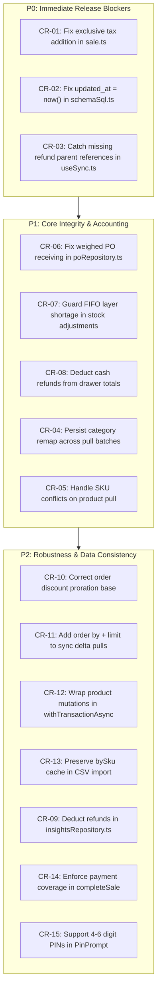

# Nurledger Technical Code Review

**Target:** `main` branch (Milestones M1–M6)  
**System:** Expo SDK 57 / React Native 0.86 / `expo-sqlite` / Supabase Cloud Sync  
**Focus:** Invariants, edge cases, crash/mid-operation recovery, distributed state, concurrency, and security.  
**Baseline:** All tests passing (`316/316`), TypeScript `tsc --noEmit` clean (`0 errors`), happy-path device-verified. Accepted deviations (`DEV-001` through `DEV-006`) are preserved and not flagged.

---

## 1. Executive Summary

Nurledger demonstrates high code quality, consistent coding conventions, and clear adherence to offline-first principles across its domain layer. The repository exhibits strict typing, robust local SQLite migrations, pure unit-testable business logic in integer minor units, and thoughtful schema definitions.

However, an exhaustive audit beyond the unit test coverage reveals critical edge cases, accounting discrepancies, distributed sync vulnerabilities, and transaction atomicity gaps that can manifest in production under network degradation, multi-device concurrency, and mid-operation app terminations.

### Summary Matrix of Findings

| ID | Severity | Category | File & Line | Summary |
|---|---|---|---|---|
| **CR-01** | **Critical** | Accounting / Invariants | `src/lib/sale.ts:113` | Exclusive tax is omitted from `saleTotals.totalMinor`, causing under-collection of funds and broken receipt math. |
| **CR-02** | **Critical** | Sync / Distributed State | `src/lib/cloud/schemaSql.ts:262, 294, 316, 340, 363` | Cloud RPCs set `updated_at` to client `created_at` instead of server `now()`, silently stranding offline sales from peer delta pulls. |
| **CR-03** | **Critical** | Sync / Reliability | `src/hooks/useSync.ts:297-299, 319-321` | Pull transaction throws unhandled exception on out-of-order refund references, creating an unrecoverable permanent sync loop. |
| **CR-04** | **High** | Sync / Schema Constraints | `src/hooks/useSync.ts:159-170, 214` | Ephemeral category remap causes foreign key failures (`product.category_id`) on subsequent product pull batches. |
| **CR-05** | **High** | Sync / Concurrency | `src/hooks/useSync.ts:194-208` | Product pull uses `ON CONFLICT (id)` which crashes SQLite on natural key collision `(outlet_id, sku)`. |
| **CR-06** | **High** | Inventory / Invariants | `src/repositories/poRepository.ts:180-189` | Receiving PO for weighed items passes `qtyDelta` instead of `qtyGDelta`, leaving on-hand gram inventory at zero. |
| **CR-07** | **High** | Inventory / Invariants | `src/repositories/stockRepository.ts:360-377`<br>`src/repositories/stocktakeRepository.ts:234-245` | Negative stock adjustments on shortage bypass FIFO layer updates while committing ledger decrements, permanently de-syncing cost layers. |
| **CR-08** | **High** | Cash Drawer / Shifts | `src/repositories/shiftRepository.ts:226-236`<br>`src/lib/shift.ts:31-33` | Drawer expected balance ignores refunds, falsely penalizing cashiers with shortages; refunds misattributed across shifts. |
| **CR-09** | **Medium** | Analytics / P&L | `src/repositories/insightsRepository.ts:17-25`<br>`src/lib/kpi.ts:8-13` | Insights and P&L aggregates completely omit refunds, overstating net revenue, units sold, and gross margin. |
| **CR-10** | **Medium** | Tax / Calculations | `src/lib/sale.ts:104-106` | Order discount proration across mixed tax lines uses unadjusted line gross instead of post-line-discount balance. |
| **CR-11** | **Medium** | Sync / Scalability | `src/lib/cloud/supabaseAdapter.ts:235-239`<br>`src/lib/sync.ts:46-52` | Delta queries lack deterministic ordering and pagination, causing cursor skips and permanent data omission when batch size > 1,000. |
| **CR-12** | **Medium** | Atomicity / Outbox | `src/repositories/productRepository.ts:200-215, 223-241, 345-349` | Master data mutations and outbox enqueues run outside database transactions, risking un-synced local mutations on crash. |
| **CR-13** | **Medium** | Data Integrity | `src/repositories/productRepository.ts:300-303, 321-322` | CSV import deletes SKU from lookup map on match, causing duplicate SKUs in the same CSV to fail with unique constraint crashes. |
| **CR-14** | **Low** | Domain Invariants | `src/repositories/saleRepository.ts:38-45` | `completeSale` lacks payment coverage validation, allowing underpaid or unbacked sales at the repository level. |
| **CR-15** | **Low** | UI / Authentication | `src/components/PinPrompt.tsx:64-70` | PIN prompt auto-submits only on 4 digits, locking out valid 5-digit and 6-digit manager PINs supported by `PIN_REGEX`. |

---

## 2. Architecture & Invariant Enforcement

### CR-01: Exclusive Tax Omitted from Sale Total
- **File & Line:** `src/lib/sale.ts:113`
- **Severity:** Critical
- **Description:**  
  In `computeTotals()`, `totalMinor` is calculated as:
  ```typescript
  const totalMinor = Math.max(0, grossAfterLineDiscount - order);
  ```
  `tax.mode` supports both `'inclusive'` and `'exclusive'` via `src/lib/tax.ts:65-66`. While `taxEngine.compute()` correctly calculates `taxMinor` in exclusive mode as `amount * rate / 100`, `computeTotals()` never adds `tax.taxMinor` to `totalMinor`.
- **Impact:**  
  When an outlet configures exclusive tax, customers are charged only the subtotal minus discount. The tax is not collected, the shop owner incurs cash shortfalls, and receipts display contradictory arithmetic:
  $$\text{Subtotal} + \text{Tax} \neq \text{Total}$$
- **Remediation:**  
  Update `computeTotals` in `src/lib/sale.ts:113`:
  ```typescript
  const baseTotal = Math.max(0, grossAfterLineDiscount - order);
  const totalMinor = tax.mode === 'exclusive' ? baseTotal + tax.taxMinor : baseTotal;
  ```

---

### CR-06: Weighed Items Received via Purchase Order Bypass Gram Inventory
- **File & Line:** `src/repositories/poRepository.ts:180-189`
- **Severity:** High
- **Description:**  
  In `receivePO()`, the stock movement for received lines is invoked as:
  ```typescript
  const move = await applyStockMoveInTx(db, {
    productId: line.productId,
    qtyDelta: remaining,
    type: 'receive_po',
    unitCostMinor: line.unitCostMinor,
    lotId,
    refType: 'po',
    refId: id,
    costLayerRef: { type: 'lot', id: lotId },
  });
  ```
  `poRepository` does not check whether `line.productId` is a weighed product (`product.is_weighed = 1`). For weighed items, inventory is stored in `stock_ledger.qty_g_delta`, and aggregated by `stock_view` as `SUM(qty_g_delta) AS qty_g`. By passing `qtyDelta: remaining` without `qtyGDelta`, `applyStockMoveInTx` writes to `qty_delta` instead of `qty_g_delta`.
- **Impact:**  
  Received stock for bulk/weighed produce (e.g. 5,000 grams of apples) is incremented under unit count rather than gram weight. The `stock_view` continues to show 0 grams on hand, causing register stockout blocks during checkout.
- **Remediation:**  
  Fetch `is_weighed` in the PO line query and branch accordingly:
  ```typescript
  const isWeighed = line.isWeighed === 1;
  const move = await applyStockMoveInTx(db, {
    productId: line.productId,
    qtyDelta: isWeighed ? 0 : remaining,
    qtyGDelta: isWeighed ? remaining : null,
    type: 'receive_po',
    unitCostMinor: line.unitCostMinor,
    lotId,
    refType: 'po',
    refId: id,
    costLayerRef: { type: 'lot', id: lotId },
  });
  ```

---

### CR-07: Negative Stock Adjustments & Stocktakes Desynchronize FIFO Layers on Shortage
- **File & Line:** `src/repositories/stockRepository.ts:360-377`, `src/repositories/stocktakeRepository.ts:234-245`, `src/components/AdjustStockDialog.tsx:68-76`
- **Severity:** High
- **Description:**  
  In `applyStockMoveInTx()`, when decrements exceed available FIFO layers:
  ```typescript
  const result = consumeFifo(layers, qty);
  const lotId = input.lotId ?? (await firstFefoLotIdInTx(db, productId));
  if (!result.short) {
    const remaining = applyConsumption(layers, result);
    for (const c of result.consumed) {
      const newQty = remaining.get(c.layerId) ?? 0;
      await db.runAsync('UPDATE cost_layer SET qty_remaining = ? WHERE id = ?', [newQty, c.layerId]);
    }
  }
  await db.runAsync(
    `INSERT INTO stock_ledger (..., qty_delta, ...) VALUES (..., -qty, ...)`,
    [...]
  );
  ```
  When `result.short === true`:
  1. The cost layer update block `if (!result.short)` is bypassed, leaving existing `cost_layer` records unchanged.
  2. The negative ledger row is inserted anyway with `-qty`.
  While `completeSale` catches `short: true` and aborts the transaction, neither `stocktakeRepository.applyStocktake` nor `stockRepository.applyStockMove` inspects `short`.
- **Impact:**  
  Applying a stocktake with negative variance or performing an inventory write-off when cost layers are partially depleted commits negative ledger entries while leaving orphaned units in `cost_layer`. Subsequent inventory valuations and sales calculations drift out of alignment with the physical stock ledger.
- **Remediation:**  
  In `stockRepository.ts:362`: When `result.short` occurs during an adjustment or stocktake, either:
  1. Deplete all remaining layers to 0 and record the remaining shortage against a zero-cost or last-known-cost fallback layer, OR
  2. Reject negative adjustments exceeding active cost layers with a clear domain error.

---

### CR-10: Order-Level Discount Proration Distorts Tax Base Across Mixed Tax Buckets
- **File & Line:** `src/lib/sale.ts:104-106`
- **Severity:** Medium
- **Description:**  
  In `computeTotals()`:
  ```typescript
  const orderShare = subtotalMinor > 0 ? roundDivide(order * lineGross, subtotalMinor) : 0;
  const taxable = Math.max(0, afterLine - orderShare);
  byCategory.set(l.taxCategory, (byCategory.get(l.taxCategory) ?? 0) + taxable);
  ```
  `orderShare` prorates the order-level discount using `lineGross / subtotalMinor` (pre-discount gross) rather than `afterLine / grossAfterLineDiscount` (post-line-discount net).
- **Impact:**  
  If Line 1 has a 100% line discount (`afterLine = 0`), it is still assigned a portion of `orderDiscountMinor`, which is then discarded by `Math.max(0, 0 - orderShare)`. Consequently, the order discount is not fully deducted from the remaining lines, overstating the taxable base on lines subject to tax.
- **Remediation:**  
  Base order discount apportionment on net post-line-discount amounts:
  ```typescript
  const orderShare = grossAfterLineDiscount > 0
    ? roundDivide(order * afterLine, grossAfterLineDiscount)
    : 0;
  const taxable = Math.max(0, afterLine - orderShare);
  ```

---

## 3. Cloud Synchronization & Distributed State

### CR-02: Backdated `updated_at` Causes Silent Peer Data Loss on Delta Pulls
- **File & Line:** `src/lib/cloud/schemaSql.ts:262, 294, 316, 340, 363`
- **Severity:** Critical
- **Description:**  
  In the Supabase schema functions (`apply_sale`, `apply_ledger`, and `apply_refund`):
  ```sql
  INSERT INTO public.sale (..., created_at, updated_at)
  VALUES (..., created_t, created_t)
  ```
  ```sql
  INSERT INTO public.stock_ledger (..., created_at, updated_at)
  VALUES (..., to_timestamp(...), to_timestamp(...))
  ```
  The `updated_at` column is explicitly set to the client's past timestamp (`created_t`) instead of the server receipt timestamp (`now()`).
  This directly violates `SYNC-DESIGN.md §3.4`:
  > *"Each synced table carries a monotonic `updated_at` server-assigned on insert/update, >= created_at. Pulls query `WHERE updated_at > cursor`."*
- **Failure Scenario:**  
  1. Device A operates offline from 08:00 to 10:00, generating sales.
  2. Device B syncs at 09:30. Its cursor for sales advances to `09:30:00`.
  3. Device A reconnects at 10:00 and drains its outbox. The sales land in Supabase with `updated_at` between `08:00:00` and `09:59:00`.
  4. Device B syncs at 10:05 with `WHERE updated_at >= '09:30:00'`.
  5. Device B **never receives** Device A's sales created between 08:00 and 09:30.
- **Impact:**  
  Permanent, silent data divergence across peer POS terminals. Sales and inventory adjustments performed offline are invisible to other devices once their cursors pass the historical creation times.
- **Remediation:**  
  In `schemaSql.ts`, assign `now()` to `updated_at` on all inserts and updates in `apply_sale`, `apply_ledger`, and `apply_refund`:
  ```sql
  INSERT INTO public.sale (..., created_at, updated_at)
  VALUES (..., created_t, now())
  ```

---

### CR-03: Missing Sale/Refund Resolution Causes Permanent Sync Lockup
- **File & Line:** `src/hooks/useSync.ts:297-299, 319-321`
- **Severity:** Critical
- **Description:**  
  During local pull ingestion in `useSync.ts`:
  ```typescript
  for (const rf of pull.refunds) {
    const saleId = saleIdByUuid.get(rf.saleUuid);
    if (!saleId) {
      throw new Error(`Pulled refund ${rf.uuid} references unknown sale uuid ${rf.saleUuid}`);
    }
  ```
  and:
  ```typescript
  for (const rl of pull.refundLines) {
    const refundId = refundIdByUuid.get(rl.refundUuid);
    if (!refundId) {
      throw new Error(`Pulled refund_line ${rl.id} references unknown refund uuid ${rl.refundUuid}`);
    }
  ```
  If a pulled refund references a `saleUuid` that is not locally present (due to decoupled cursor progression or network batch chunking), an unhandled exception is thrown inside `db.withTransactionAsync()`.
- **Impact:**  
  The transaction rolls back, preventing cursor advancement. On every subsequent sync interval, the server returns the same batch, the client hits the same missing reference, and sync is permanently wedged.
- **Remediation:**  
  Do not abort the entire pull transaction. If a parent sale or refund is not yet present, skip the dependent record, record a diagnostic warning, and do not advance that specific table's cursor past the unresolvable entity until the parent is ingested.

---

### CR-04: Ephemeral Category Remap Causes Foreign Key Crashes on Product Pulls
- **File & Line:** `src/hooks/useSync.ts:159-170, 214`, `src/db/schema.ts:122`
- **Severity:** High
- **Description:**  
  In `useSync.ts`:
  ```typescript
  const catIdRemap = new Map<string, string>();
  if (pull.categories.length > 0) {
    // ... populates catIdRemap ...
  }
  // Later in product loop:
  p.categoryId ? (catIdRemap.get(p.categoryId) ?? p.categoryId) : null
  ```
  `catIdRemap` is an in-memory map instantiated only when `pull.categories.length > 0`. If a remote category ID was remapped during an earlier pull, subsequent pull ticks where `pull.categories.length === 0` but `pull.products.length > 0` evaluate `catIdRemap.get(p.categoryId) ?? p.categoryId` to the raw remote ID.
- **Impact:**  
  Because `product.category_id REFERENCES category(id)` (`src/db/schema.ts:122`), SQLite throws a `FOREIGN KEY constraint failed` error, crashing the pull transaction.
- **Remediation:**  
  Maintain category ID remapping persistently in a lookup table (e.g. `remote_category_map(remote_id, local_id)`), or resolve the local category ID by querying `category` by name.

---

### CR-05: Concurrent Product SKU Collision Wedges SQLite Pull Transaction
- **File & Line:** `src/hooks/useSync.ts:194-208`, `src/db/schema.ts:139`
- **Severity:** High
- **Description:**  
  In `useSync.ts`, product updates are inserted using:
  ```sql
  INSERT INTO product (...) VALUES (...)
  ON CONFLICT (id) DO UPDATE SET ...
  ```
  However, `src/db/schema.ts:139` defines:
  ```sql
  CREATE UNIQUE INDEX IF NOT EXISTS idx_product_sku ON product(outlet_id, sku);
  ```
  If Device A and Device B create products offline with the same SKU under different client UUIDs (`id_A` vs `id_B`), when Device B pulls Device A's product, `ON CONFLICT (id)` does not trigger. Instead, the secondary unique index `idx_product_sku` triggers:
  ```
  UNIQUE constraint failed: product.outlet_id, product.sku
  ```
- **Impact:**  
  The pull transaction aborts. Sync remains blocked permanently because the conflicting row is continually pulled.
- **Remediation:**  
  Handle SKU collisions during pull resolution. Query local products by `(outlet_id, sku)`. If a matching SKU exists with a different UUID, resolve according to LWW rules or quarantine the incoming item with an amended SKU (`SKU-CONFLICT-<uuid>`).

---

### CR-11: Unbounded Delta Pulls Lack Pagination and Deterministic Sorting
- **File & Line:** `src/lib/cloud/supabaseAdapter.ts:235-239`, `src/lib/sync.ts:46-52`
- **Severity:** Medium
- **Description:**  
  In `SupabaseCloudAdapter.pullDeltas()`:
  ```typescript
  c.from('sale').select('*').eq('outlet_id', cfg.outletId).gte('updated_at', isoSince(cursors.sale))
  ```
  PostgREST enforces a server default page size limit (typically 1,000 rows). Queries lack `.order('updated_at', { ascending: true })` and pagination controls.
  In `advanceCursor()`, the cursor is calculated as `Math.max(...rows.map((r) => r.updatedAt))`.
- **Impact:**  
  If more than 1,000 records have updated since the cursor, PostgREST returns an arbitrary 1,000 rows. The client advances its cursor to the highest `updated_at` in that partial set. Any omitted rows with an `updated_at` earlier than the new cursor are skipped and never synchronized.
- **Remediation:**  
  Add explicit sorting and pagination to delta queries:
  ```typescript
  c.from(table)
    .select('*')
    .eq('outlet_id', cfg.outletId)
    .gte('updated_at', isoSince(cursor))
    .order('updated_at', { ascending: true })
    .limit(PULL_PAGE_SIZE);
  ```
  Advance the cursor only to the timestamp of the last contiguous processed record.

---

## 4. Cash Drawer Reconciliation & Accounting Integrity

### CR-08: Cash Drawer Expected Balance Omits Refunds, Guaranteeing False Z-Report Variances
- **File & Line:** `src/repositories/shiftRepository.ts:226-236`, `src/lib/shift.ts:31-33`
- **Severity:** High
- **Description:**  
  In `src/lib/shift.ts`:
  ```typescript
  export function expectedCashMinor(t: CashTotals): number {
    return t.floatMinor + t.cashSaleMinor + t.cashInMinor - t.cashOutMinor;
  }
  ```
  And in `closeShift()`:
  ```typescript
  const totals = { floatMinor: shift.floatMinor, cashSaleMinor, cashInMinor, cashOutMinor };
  const expected = expectedCashMinor(totals);
  ```
  Refund amounts paid in cash out of the drawer are not included in `CashTotals` and are never subtracted from `expectedCashMinor`.
  Furthermore, `refundsRow` is queried as:
  ```sql
  SELECT COALESCE(SUM(r.amount_minor), 0) AS n
  FROM refund r JOIN sale s ON s.id = r.sale_id
  WHERE s.shift_id = ?
  ```
  This joins on the sale's original `shift_id`.
- **Impact:**  
  1. Any cash refund issued during a shift causes an artificial cash shortage on the Z-report:
     $$\text{Variance} = \text{Counted} - \text{Expected} = -\text{Cash Refund Amount}$$
     Cashiers are falsely flagged for missing cash.
  2. If a refund is issued on Shift B for a sale made during Shift A, Shift A's closed report is retroactively associated with the refund, while Shift B's cash drawer balance remains unadjusted.
- **Remediation:**  
  1. Add `shift_id` and `payment_method` to the `refund` table.
  2. Update `CashTotals` and `expectedCashMinor` to subtract `cashRefundMinor`:
     ```typescript
     export function expectedCashMinor(t: CashTotals): number {
       return t.floatMinor + t.cashSaleMinor + t.cashInMinor - t.cashOutMinor - t.cashRefundMinor;
     }
     ```

---

### CR-09: Insights & P&L Analytics Omit Refunds from Revenue and Cost Calculations
- **File & Line:** `src/repositories/insightsRepository.ts:17-25`, `src/lib/kpi.ts:8-13`
- **Severity:** Medium
- **Description:**  
  `getPeriodTotals()` in `insightsRepository.ts` aggregates:
  ```sql
  SELECT COUNT(*) AS tx,
         COALESCE(SUM(subtotal_minor), 0) AS subtotal,
         COALESCE(SUM(discount_minor), 0) AS discount,
         COALESCE(SUM(tax_minor), 0) AS tax,
         COALESCE(SUM(total_minor), 0) AS gross,
         COALESCE(SUM(cogs_minor), 0) AS cogs
  FROM sale WHERE status = 'completed' AND created_at >= ?
  ```
  Neither `insightsRepository.ts` nor `kpi.ts` queries the `refund` or `refund_line` tables. When a sale is refunded, `sale.status` remains `'completed'`, and no deductions are made from `gross`, `cogs`, or `unitsSold`.
- **Impact:**  
  The Insights dashboard displays inflated gross sales, distorted net revenue, and inaccurate inventory turnover metrics following product returns.
- **Remediation:**  
  Subtract refund totals and restocked COGS from period metrics:
  ```sql
  SELECT 
    (SELECT COALESCE(SUM(total_minor), 0) FROM sale WHERE status = 'completed' AND created_at >= ?) -
    (SELECT COALESCE(SUM(amount_minor), 0) FROM refund WHERE created_at >= ?) AS net_gross
  ```

---

## 5. Transaction Atomicity, Crash Recovery & Data Integrity

### CR-12: Non-Atomic Master Data Mutations Risk Lost Outbox Enqueues
- **File & Line:** `src/repositories/productRepository.ts:200-215, 223-241, 345-349`
- **Severity:** Medium
- **Description:**  
  `createProduct`, `updateProduct`, and `deactivateProduct` execute local updates and outbox enqueues sequentially without a wrapping transaction:
  ```typescript
  await db.runAsync('INSERT INTO product (...) VALUES (...)', [...]);
  await enqueueOpInTx(db, 'product', id);
  ```
- **Impact:**  
  If the application process is terminated (e.g. OS memory reclamation, low battery shutoff) between `db.runAsync` and `enqueueOpInTx`, the local product table is modified, but no outbox operation is created. The change is never pushed to Supabase or other devices.
- **Remediation:**  
  Wrap operations in `db.withTransactionAsync()`:
  ```typescript
  await db.withTransactionAsync(async () => {
    await db.runAsync(...);
    await enqueueOpInTx(db, 'product', id);
  });
  ```

---

### CR-13: In-Batch SKU Deletion in CSV Import Causes Fatal Unique Constraint Crash
- **File & Line:** `src/repositories/productRepository.ts:300-303, 321-322`
- **Severity:** Medium
- **Description:**  
  In `importProducts()`:
  ```typescript
  const existingId = bySku.get(row.sku.toLowerCase());
  if (existingId !== undefined) {
    bySku.delete(row.sku.toLowerCase());
    await db.runAsync(`UPDATE product SET ... WHERE id = ?`, [...]);
  } else {
    const id = uuidv4();
    bySku.set(row.sku.toLowerCase(), id);
    await db.runAsync(`INSERT INTO product ...`, [...]);
  }
  ```
  When an existing product is encountered, its SKU is deleted from `bySku`. If the CSV file contains duplicate entries for that SKU, the subsequent entry finds `existingId === undefined` and attempts to `INSERT` a new row with the same SKU under a new UUID.
- **Impact:**  
  SQLite throws `UNIQUE constraint failed: product.outlet_id, product.sku`, rolling back the entire import.
- **Remediation:**  
  Do not delete entries from `bySku`. Maintain the mapping so that subsequent CSV rows for the same SKU update the existing record.

---

### CR-14: Absence of Payment Coverage Enforcement in Domain Repository
- **File & Line:** `src/repositories/saleRepository.ts:38-45`
- **Severity:** Low
- **Description:**  
  `completeSale()` validates that lines are non-empty and totals are non-negative, but does not verify that `input.payments` sums to `totals.totalMinor`.
- **Impact:**  
  While the UI modal enforces payment matching, any script, migration, or programmatic caller can commit a `'completed'` sale with zero or partial payments, corrupting accounting invariants.
- **Remediation:**  
  Add repository-level verification:
  ```typescript
  const paid = input.payments.reduce((sum, p) => sum + p.amountMinor, 0);
  if (paid < totals.totalMinor) {
    throw new Error(`Insufficient payment: paid ${paid}, expected ${totals.totalMinor}`);
  }
  ```

---

## 6. Authentication, Security & Permissions

### CR-15: Manager PIN Auto-Submit Hardcodes 4 Digits
- **File & Line:** `src/components/PinPrompt.tsx:64-70`, `src/lib/pin.ts:8`
- **Severity:** Low
- **Description:**  
  `src/lib/pin.ts:8` permits PINs between 4 and 6 digits:
  ```typescript
  export const PIN_REGEX = /^\d{4,6}$/;
  ```
  However, `PinPrompt.tsx:64` triggers verification strictly when `enteredPin.length === 4`:
  ```typescript
  if (next.length === 4) {
    handleVerify(next);
  }
  ```
- **Impact:**  
  Managers configured with valid 5-digit or 6-digit PINs cannot authenticate via the PIN prompt keypad, effectively locking them out of elevated operations (e.g. price overrides, drawer openings, stock write-offs).
- **Remediation:**  
  Provide an explicit "Enter" / submit button on the keypad or evaluate length dynamically against active user credential policies.

---

## 7. Remediation Priority Roadmap


